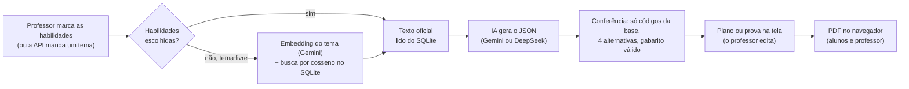

# Agente BNCC para professores

[](https://github.com/GuilhermeScarpini/agente-bncc-professores/actions/workflows/ci.yml)
[](LICENSE)

Gera **planos de aula** e **provas com gabarito** ancorados nas habilidades oficiais da **BNCC** (Base Nacional Comum Curricular). O professor escolhe as habilidades em menus e recebe um material pronto para revisar, editar e baixar em PDF. Sistemas de escola usam o mesmo agente por uma API.

O ponto central é a confiabilidade: a IA escreve o texto, mas os códigos e a descrição de cada habilidade vêm sempre da base oficial. Um código inventado pela IA é descartado antes de chegar ao professor.

## O que ele faz

- **Planos de aula** a partir de até 5 habilidades, com objetivos, metodologia passo a passo e avaliação formativa.
- **Provas com gabarito**: de 3 a 20 questões (mistas, só objetivas ou só discursivas), cada uma ligada a uma habilidade.
- **Seleção por ano e bimestre**, juntando habilidades de períodos diferentes (para turmas que retomam conteúdos de anos anteriores).
- **Edição da prova**: o professor muda título e ano, edita, exclui e adiciona questões. Numa questão escrita à mão, "Procurar código BNCC" acha a habilidade que combina com o texto.
- **PDFs** do plano e da prova em duas versões: a dos alunos (só as questões, com imagens) e a do professor (gabarito, critérios e o código BNCC de cada questão).
- **API v1** com chave para outros sistemas, e **escolha da IA** em cada pedido: Gemini ou DeepSeek.

## Destaques técnicos

- **Geração ancorada (RAG).** As habilidades vêm do banco, com o texto literal da BNCC (1.580, extraídas do PDF do MEC). O JSON Schema da resposta só aceita os códigos enviados, e uma conferência depois da IA descarta códigos de fora, questões sem as 4 alternativas, alternativas repetidas e gabaritos inválidos.
- **Busca semântica sem serviço extra.** Os embeddings (`gemini-embedding-2`, 768 dimensões) ficam no próprio SQLite. A busca filtra por disciplina e ano no banco e ordena por cosseno em memória: são cerca de 1.600 vetores, o que leva milissegundos e dá resultado exato. O limiar de "encaixa" (0,63) foi medido com questões reais.
- **Duas IAs, um contrato.** Gemini (com o formato de resposta imposto pela API) e DeepSeek (com o schema nas instruções) passam pela mesma validação com Zod. Há timeout, novas tentativas com espera, erros tipados que viram mensagens em português e cancelamento propagado: se o professor cancela, a chamada à IA também para.
- **PDF no navegador.** As provas e os planos são montados no navegador com `pdf-lib`, com quebra de linha e de página próprias. As imagens que o professor anexa nunca saem do computador dele.
- **Segurança e custo.** A API exige `Authorization: Bearer`, conferido em tempo constante. As páginas exigem senha, com sessão em cookie assinado. Há limites de uso por IP nas páginas e um limite geral na API, as rotas só aceitam JSON (o que barra formulários de outros sites) e todos os pedidos passam por validação.
- **Qualidade.** TypeScript estrito, quase 100 testes com `node:test` (prompts, validação, conferência das respostas, PDFs) e CI com tipos, lint, testes e build a cada push.
- **Deploy simples.** Roda no plano gratuito da Vercel: o banco SQLite com os vetores vai junto no pacote e é aberto só para leitura, sem banco externo.

## Como funciona



## Demonstração

O agente está publicado em <https://agente-bncc.vercel.app>. As páginas pedem senha, porque cada geração gasta créditos de IA. O `GET /api/v1/status` é público e mostra se o agente está pronto.

**Stack:** Next.js 16 (App Router), React 19 e TypeScript estrito, com Tailwind CSS 4. Os dados ficam em SQLite com Prisma 7. A busca usa o `gemini-embedding-2`; a geração usa o `gemini-3.5-flash` (cerca de 5 s por plano) ou o DeepSeek (`deepseek-flash` ou `deepseek-v4-pro`). Os PDFs usam `pdf-lib`, e a validação, Zod.

## Em detalhes

Na página de demonstração (`/`), o professor não precisa digitar o tema: escolhe a disciplina (as 8 da BNCC no 1º ao 5º ano), o ano e o bimestre nos menus, vê a lista de habilidades daquele período com o texto oficial e marca de 1 a 5 habilidades. Trocar o ano ou o bimestre não desmarca nada: dá para juntar habilidades de períodos diferentes (uma turma com defasagem retoma as de anos anteriores), e as marcadas ficam numa lista com o ano e o bimestre de cada uma. Se quiser, escreve um complemento (turma, tempo, recursos, adaptações). O plano sai preenchido a partir dessas habilidades, com componente curricular, ano e bimestre no cabeçalho: o ano só aparece quando todas são do mesmo ano, e o bimestre, quando todas são do mesmo bimestre.

Pela API, também dá para mandar um tema livre e, se quiser, filtrar por disciplina e ano escolar. Nesse caso o agente:

1. busca as habilidades da BNCC mais parecidas com o tema: filtra por disciplina e ano no banco e ordena por similaridade semântica;
2. pede à IA (Gemini ou DeepSeek) um plano ancorado nessas habilidades, com os códigos e a justificativa, os objetivos de aprendizagem, a metodologia passo a passo e a avaliação formativa;
3. confere a resposta: só aparecem códigos que vieram da base, sempre com o texto oficial da BNCC.

No mesmo estilo, ele também gera **provas com gabarito** (página `/provas`): a professora escolhe as habilidades, o número de questões (3 a 20) e o formato (mista, só objetivas ou só discursivas). Cada questão fica ligada a uma habilidade, as de múltipla escolha têm 4 alternativas, e o gabarito traz a resposta e os critérios de correção. Na página, a professora edita, exclui e adiciona questões. Numa questão escrita à mão, o botão "Procurar código BNCC" busca a habilidade que combina com o texto (na disciplina da prova, do ano da turma para trás): se uma encaixa bem, o código já entra na questão; se nenhuma encaixa, a questão pode ficar sem código. Ela também ajusta o título e o ano da prova (a IA sugere, ela muda se quiser; o cabeçalho da prova não leva bimestre), pode anexar uma imagem a cada questão (do computador, com uma descrição para quem não enxerga) e baixa a prova em PDF em duas versões: **para os alunos** (só as questões, com espaço para nome e data) e **para o professor** (cada questão com o código BNCC, a resposta e os critérios, e a lista das habilidades avaliadas). O plano de aula também sai em PDF. Os PDFs são montados no navegador com `pdf-lib`, e as imagens ficam só lá: o agente não guarda arquivos, e elas somem ao gerar outra prova ou recarregar a página.

Ele funciona sozinho (há páginas de demonstração em `/` e `/provas`) e também como API para outros sistemas, como a rede social escolar turma-social (repositório privado).

## Como rodar

Requisitos: Node.js 20 ou mais novo, e npm.

```bash
npm install
```

1. O `npm install` cria o `.env` com uma `AGENTE_BNCC_API_KEY` aleatória.
2. Crie uma chave gratuita do Gemini em https://aistudio.google.com/apikey e coloque no `.env`: `GEMINI_API_KEY="sua-chave"`.
3. Carregue a BNCC, uma vez só:

   ```bash
   npm run db:seed-bncc
   ```

   O seed grava as 1.580 habilidades e gera os embeddings em lotes de 100. Se a cota gratuita acabar no meio, rode de novo mais tarde: o progresso fica salvo e só o que falta é enviado.

4. Suba o servidor:

   ```bash
   npm run dev
   ```

   A demonstração abre em http://localhost:3200.

## Scripts

| Comando                | O que faz                                                         |
| ---------------------- | ----------------------------------------------------------------- |
| `npm run dev`          | Prepara o `.env` e o banco e sobe o servidor na porta 3200        |
| `npm run db:seed-bncc` | Carrega a BNCC e gera os embeddings (precisa da `GEMINI_API_KEY`) |
| `npm run build`        | Build de produção                                                 |
| `npm start`            | Servidor de produção na porta 3200 (depois do build)              |
| `npm test`             | Testes                                                            |
| `npm run lint`         | ESLint                                                            |
| `npm run typecheck`    | Checagem de tipos do TypeScript                                   |
| `npm run db:studio`    | Abre o Prisma Studio para ver os dados                            |

## API (v1)

Todas as respostas seguem o formato `{ "ok": true, "data": ... }` ou `{ "ok": false, "error": "mensagem em português", "fieldErrors"?: { campo: [mensagens] } }`.

### `POST /api/v1/planos`

Gera um plano. Exige o cabeçalho `Authorization: Bearer <AGENTE_BNCC_API_KEY>`.

```bash
curl -X POST http://localhost:3200/api/v1/planos \
  -H "Authorization: Bearer $AGENTE_BNCC_API_KEY" \
  -H "Content-Type: application/json" \
  -d '{"tema": "frações equivalentes com receitas", "componente": "Matemática", "anoEscolar": "ef-6"}'
```

| Campo        | Obrigatório | Descrição                                                     |
| ------------ | ----------- | ------------------------------------------------------------- |
| `tema`        | sim, sem `habilidades` | O que trabalhar na aula (3 a 500 caracteres)       |
| `llm`         | não         | IA que gera: `"gemini"` ou `"deepseek"`. Sem ele, vale `LLM_PROVIDER` |
| `modelo`      | não         | Modelo da IA (ex.: `"deepseek-v4-pro"`). Sem ele, o padrão da IA escolhida |
| `habilidades` | sim, sem `tema` | Lista de 1 a 5 códigos BNCC escolhidos (ex.: `["EF03MA07", "EF03MA08"]`): o plano usa todos, sem busca semântica |
| `complemento` | não         | Orientações do professor: turma, tempo, recursos, adaptações (até 500 caracteres) |
| `componente`  | não         | Disciplina, exatamente como em `GET /api/v1/catalogo`         |
| `anoEscolar`  | não         | Valor de ano escolar de `GET /api/v1/catalogo` (ex.: `ef-6`, `em`) |
| `bimestre`    | não         | `1` a `4`; aparece no cabeçalho do plano e no pedido ao Gemini |

Com `habilidades`, `componente` e `anoEscolar` (se vierem) precisam combinar com cada código.

A resposta (`data`) traz:

- `origem`: `habilidade_escolhida` ou `busca_semantica`;
- `identificacao`: `componente`, `ano` e `bimestre` escolhidos (cada um pode ser `null`);
- `complemento`: as orientações do professor, ou `null`;
- `titulo`, `duracao`, `objetivos`, `metodologia` (etapas com tempo) e `avaliacao` (instrumentos);
- `habilidades`: os códigos escolhidos, com o texto oficial, componente, ano e justificativa;
- `aviso`: preenchido quando as habilidades encontradas não cobrem bem o tema;
- `resumoParaFeed`: texto curto para compartilhar com a turma, sem códigos;
- `consultadas`: todas as habilidades recuperadas, com a similaridade;
- `texto`: o plano inteiro em texto simples, pronto para copiar.

| Status | Quando                                                                    |
| ------ | ------------------------------------------------------------------------- |
| 400    | Corpo inválido (veja `fieldErrors`)                                       |
| 401    | Chave de API ausente ou errada                                            |
| 415    | O corpo não foi enviado como JSON                                         |
| 422    | Nenhuma habilidade para os filtros, ou o tema não pôde ser ancorado       |
| 402    | Os créditos da IA acabaram (saldo do DeepSeek)                             |
| 429    | Limite atingido: 30 planos a cada 10 minutos, ou cota da IA (veja `Retry-After`) |
| 502    | A IA devolveu uma resposta fora do formato                                 |
| 503    | IA sem chave (`GEMINI_API_KEY` / `DEEPSEEK_API_KEY`), BNCC não carregada ou IA fora do ar |
| 504    | A IA demorou demais                                                        |

A geração leva cerca de 5 segundos com o Gemini e uns 10–15 com o DeepSeek Flash (mais, se a IA estiver sobrecarregada). Se o cliente cancelar a requisição, o agente também interrompe a chamada à IA. A resposta traz `ia: { provedor, modelo }`, com a IA que gerou.

### `POST /api/v1/provas`

Gera uma prova com gabarito. Exige o mesmo cabeçalho `Authorization` e aceita os mesmos campos do plano (`tema` ou `habilidades`, `complemento`, `componente`, `anoEscolar`, `bimestre`, `llm`, `modelo`), mais:

| Campo        | Obrigatório | Descrição                                                         |
| ------------ | ----------- | ----------------------------------------------------------------- |
| `quantidade` | não         | Número de questões, de 3 a 20 (padrão: 10)                        |
| `formato`    | não         | `mista` (padrão, ~70% objetivas), `objetivas` ou `discursivas`     |

```bash
curl -X POST http://localhost:3200/api/v1/provas \
  -H "Authorization: Bearer $AGENTE_BNCC_API_KEY" \
  -H "Content-Type: application/json" \
  -d '{"habilidades": ["EF03MA07", "EF03MA08"], "anoEscolar": "ef-3", "bimestre": 2, "quantidade": 8}'
```

A resposta (`data`) traz `origem`, `identificacao`, `complemento`, `titulo`, `instrucoes`, `habilidades` (com o texto oficial), `aviso` e:

- `questoes`: cada uma com `numero`, `habilidade` (código), `topico` (o que a questão avalia, até 80 caracteres), `tipo` (`multipla_escolha` ou `discursiva`), `enunciado`, `alternativas` (`[{ "letra": "A", "texto": "..." }]`, vazio nas discursivas), `resposta` (a letra, ou a resposta esperada) e `criterios`;
- `textoProva`: a prova para os estudantes, sem respostas nem códigos;
- `textoGabarito`: o gabarito com a habilidade e os critérios de cada questão.

O agente descarta questões com código de fora da base, sem as 4 alternativas ou com gabarito inválido, e tira os códigos BNCC do texto que os estudantes leem. Se uma habilidade escolhida ficar sem questão, `aviso` diz qual. Planos e provas dividem o mesmo limite de uso (30 a cada 10 minutos na API, 5 por IP na demonstração), porque gastam a mesma cota do Gemini.

### `GET /api/v1/catalogo`

Lista as disciplinas (agrupadas por etapa) e os anos escolares aceitos nos filtros. É pública.

### `GET /api/v1/calendario`

Os mesmos menus das páginas: `disciplinas` → `anos` → `bimestres` → `habilidades` (`codigo` e `descricao` oficial), com `disponivel` em cada disciplina e ano. Serve para o sistema cliente montar a escolha de habilidades e mandar os códigos em `habilidades`. É pública (dados abertos da BNCC), tem cerca de 200 KB e pode ficar em cache: só muda quando `prisma/data/bncc-bimestres.json` muda.

### `GET /api/v1/status`

Diz se o agente está pronto (`pronto`, `configurado`, `habilidades`), qual IA gera por padrão (`provedorGeracao`, `modeloGeracao`), quais IAs têm chave (`provedores`) e se a busca por tema está ligada (`buscaPorTema`, que precisa do Gemini). É pública e serve de health check.

## Como um sistema cliente se conecta

1. Rode o agente e copie a `AGENTE_BNCC_API_KEY` do `.env` dele.
2. No `.env` do cliente, guarde a URL do agente e a chave, por exemplo `AGENTE_BNCC_URL="http://localhost:3200"` e `AGENTE_BNCC_API_KEY="..."`.
3. Chame `POST /api/v1/planos` e `POST /api/v1/provas` **pelo servidor do cliente**, nunca pelo navegador: a chave não pode chegar ao usuário. Aplique no cliente o limite por usuário e as permissões (no turma-social, só a professora gera planos).
4. Para os menus, leia `GET /api/v1/calendario` (pode ser pelo servidor, com cache).

No turma-social, uma prova `formato: "objetivas"` vira o rascunho da "Nova avaliação" assim: `enunciado` → `statement`, `alternativas` A–D → `optionA`…`optionD`, `resposta` → `correctAnswer`, `topico` → `topic`, `habilidade` → `bnccSkill` e `criterios` → `explanation`. Os tamanhos cabem nos limites de lá, e o agente já descarta alternativas repetidas, "Todas as anteriores" e "Não sei".

## Dados e modelos

- **Habilidades:** `prisma/data/bncc-habilidades.json` tem o código e a descrição literais de todas as habilidades da BNCC homologada (93 da Educação Infantil, 1.304 do Ensino Fundamental e 183 do Ensino Médio), extraídos do PDF oficial do MEC. Etapa, ano e componente são derivados do código.
- **Bimestres:** a BNCC define as habilidades por ano, não por bimestre. A distribuição usada nos menus fica em `prisma/data/bncc-bimestres.json` (disciplina → ano → bimestre → códigos). O arquivo vem com uma **sugestão** para as 8 disciplinas do 1º ao 5º ano (Língua Inglesa só começa no 6º): Matemática foi distribuída à mão em progressão espiral; as demais, em 4 blocos seguidos na ordem dos códigos, com as habilidades de faixa (ex.: EF15AR, EF35LP) em todos os anos que cobrem. Edite-o para seguir o currículo da sua rede: um ano ou disciplina sem códigos aparece como "em breve", e códigos de outra disciplina ou de outro ano são recusados com uma mensagem que diz qual linha corrigir.
- **Outra fonte:** `npm run db:seed-bncc -- --arquivo habilidades.csv` aceita CSV (separado por `;`, `,` ou tab) ou JSON, com as colunas `id` (ou `codigo`) e `descricao`, e, opcionalmente, `unidade_tematica` e `objeto_conhecimento`. Use `-- --forcar` para recalcular todos os embeddings.
- **Busca:** os embeddings (768 dimensões) ficam na tabela `bncc_habilidades` do SQLite. A comparação com o tema é feita em memória: são cerca de 1.600 vetores, o que leva poucos milissegundos e dá um resultado exato.
- **Qual IA gera:** Gemini ou DeepSeek. `LLM_PROVIDER` (`gemini`, o padrão, ou `deepseek`) define a IA de sempre, e cada pedido pode escolher outra com `llm` e `modelo`. Nas páginas, o professor escolhe a IA antes de gerar: o DeepSeek vem marcado como recomendado, com o modelo à escolha (Flash, o recomendado, ou V4 Pro); o Gemini usa o modelo padrão (`GEMINI_MODEL`). Uma IA sem chave aparece desabilitada. O DeepSeek é pré-pago (`DEEPSEEK_API_KEY`, em https://platform.deepseek.com) e não tem cota diária como o plano gratuito do Gemini; os modelos são `deepseek-flash` (padrão, ~13 s para 5 questões) e `deepseek-v4-pro` (~37 s, explicações mais detalhadas). `DEEPSEEK_EFFORT` (`low`, o padrão, `high` ou `max`) controla quanto ele raciocina. O DeepSeek não aceita o "formato obrigatório" do Gemini: o JSON Schema vai nas instruções, e a resposta passa pela mesma conferência. A **busca por tema** usa os embeddings do Gemini (o DeepSeek não tem); pedidos com `habilidades` escolhidas não precisam dela.
- **Geração (Gemini):** para trocar o modelo, defina `GEMINI_MODEL` no `.env`; `GEMINI_THINKING_LEVEL` (`low`, `medium` ou `high`) controla quanto os modelos Gemini 3+ raciocinam antes de responder. Medido em outubro de 2026, com o mesmo pedido: `gemini-3.5-flash` + `low` levou 4–5 s; `gemini-3.8-flash`, 18–24 s; os modelos `-lite`, ~3 s, mas escrevendo sem acentos. O `text-embedding-004` não é usado porque o Google o desligou em janeiro de 2026.
- **Privacidade:** o tema é enviado à API do Google (e, com o DeepSeek, aos servidores dele, na China), e no plano gratuito o Google pode usar esse conteúdo para melhorar os produtos dele. Não envie nomes nem dados de alunos no tema nem no complemento.

## Estrutura

```
app/                 páginas de demonstração (/ e /provas) e rotas da API (api/v1, api/demo)
components/          interface (bncc/ = seleção de habilidades, escolha da IA, plano, prova e editor de questão; ui/ = campos e botões)
hooks/               chamada ao gerador com cancelamento, cópia e download dos PDFs
lib/ai/              clientes do Gemini e do DeepSeek (timeout, novas tentativas, erros tipados)
lib/bncc/            códigos da BNCC, bimestres, busca vetorial, prompt, validação da resposta e serviço
lib/pdf/             PDFs do plano e da prova (montados no navegador com pdf-lib)
prisma/              schema e dados da BNCC (data/: habilidades e distribuição por bimestre)
scripts/             preparação do .env e seed da BNCC
```

## Produção (Vercel)

O agente roda no plano gratuito (Hobby) da Vercel. O servidor só **lê** a base: o `bncc.db`, com as habilidades e os vetores, vai no repositório e no pacote da função (`outputFileTracingIncludes` em `next.config.ts`) e é aberto em modo somente leitura. Não é preciso rodar o seed no servidor.

1. Rode o seed no seu computador até o fim (`npm run db:seed-bncc` mostra "Pronto!") e faça commit do `bncc.db`. Repita sempre que mudar `prisma/data/bncc-habilidades.json`.
2. Na Vercel: **Add New → Project**, escolha este repositório. O framework (Next.js) e os comandos são detectados sozinhos.
3. Em **Settings → Environment Variables**, cadastre:
   - `GEMINI_API_KEY`: a chave do Gemini (embeddings da busca por tema e, se for a IA escolhida, a geração);
   - `DEEPSEEK_API_KEY` e `LLM_PROVIDER="deepseek"`: para gerar com o DeepSeek (opcional);
   - `AGENTE_BNCC_API_KEY`: uma chave longa e aleatória (ex.: `openssl rand -base64 32`), a mesma que o turma-social vai usar;
   - `ACESSO_SENHA`: a senha das páginas de planos e provas.

   `DATABASE_URL` não precisa: o padrão é `file:./bncc.db`.
4. Publique. Confira `https://<seu-projeto>.vercel.app/api/v1/status`: `pronto: true` e `habilidades: 1580`.

Cuidados:

- **Senha:** sem `ACESSO_SENHA`, as páginas ficam fechadas em produção (abertas só no `npm run dev`). As rotas `/api/demo/*`, que as páginas usam, também exigem a sessão. Trocar a senha desconecta todo mundo.
- **Limites de uso:** ficam em memória, por instância do servidor. Na Vercel, cada instância conta separado, então os limites são aproximados; a senha e a chave da API são a proteção principal.
- **Uso:** o plano Hobby da Vercel é para uso pessoal e não comercial.

## Problemas comuns

- **`npm install` ou `npm run db:seed-bncc` falham com `UNABLE_TO_GET_ISSUER_CERT_LOCALLY`:** a rede, geralmente de empresa, intercepta HTTPS. Rode o comando com `NODE_OPTIONS=--use-system-ca`, por exemplo `NODE_OPTIONS=--use-system-ca npm run db:seed-bncc` no Git Bash.
- **`better-sqlite3` tenta compilar e pede o Visual Studio:** a versão está fixada em `12.11.1`, que tem binário pronto para Windows.

## Licença

[MIT](LICENSE). Os textos das habilidades são da BNCC, documento público do Ministério da Educação.
